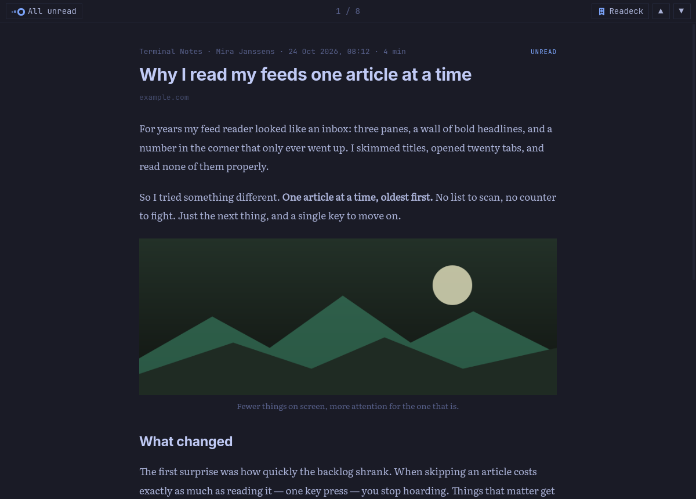
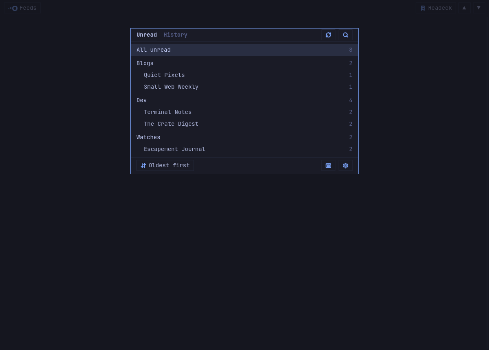
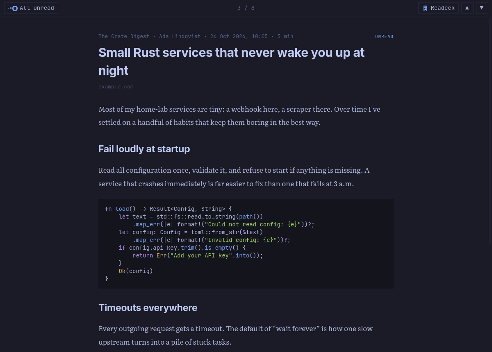
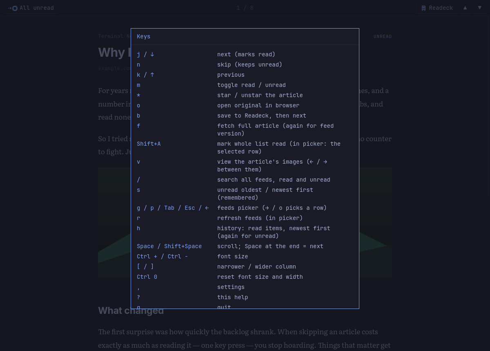
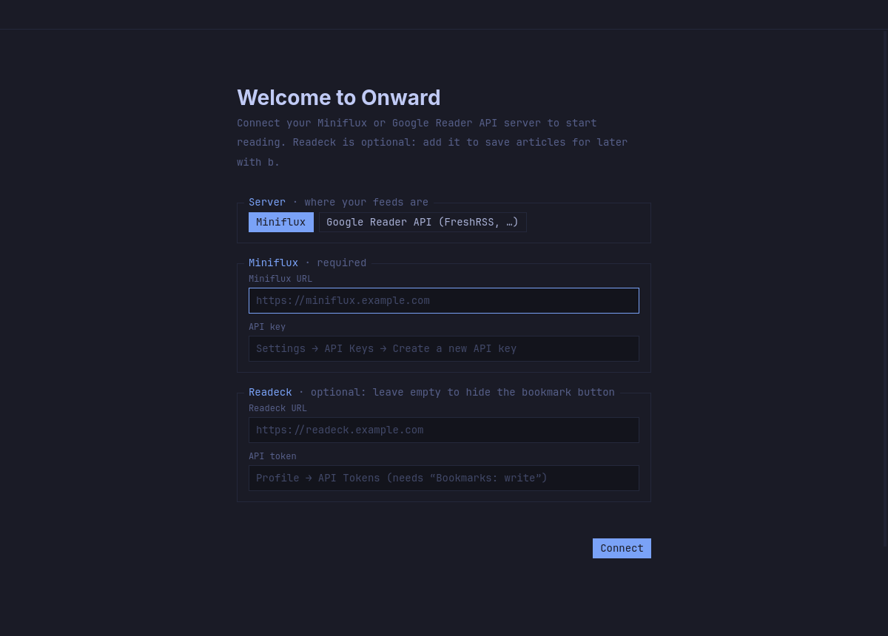
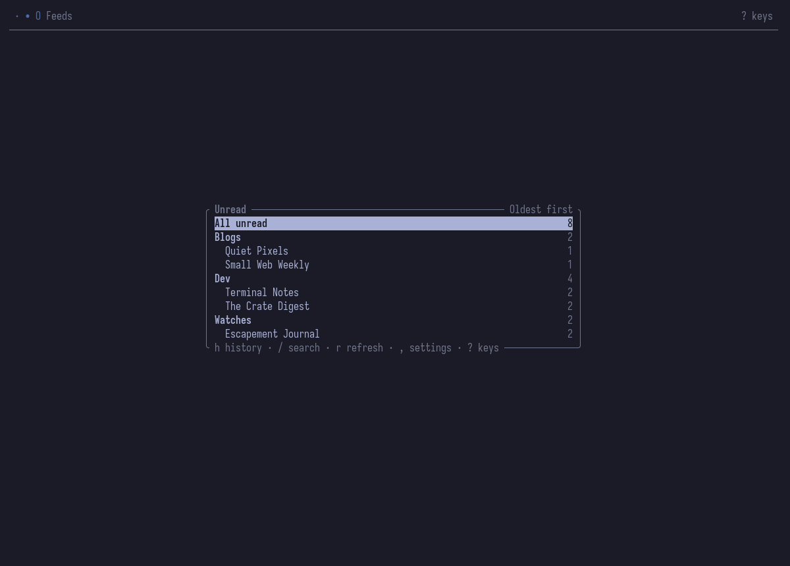
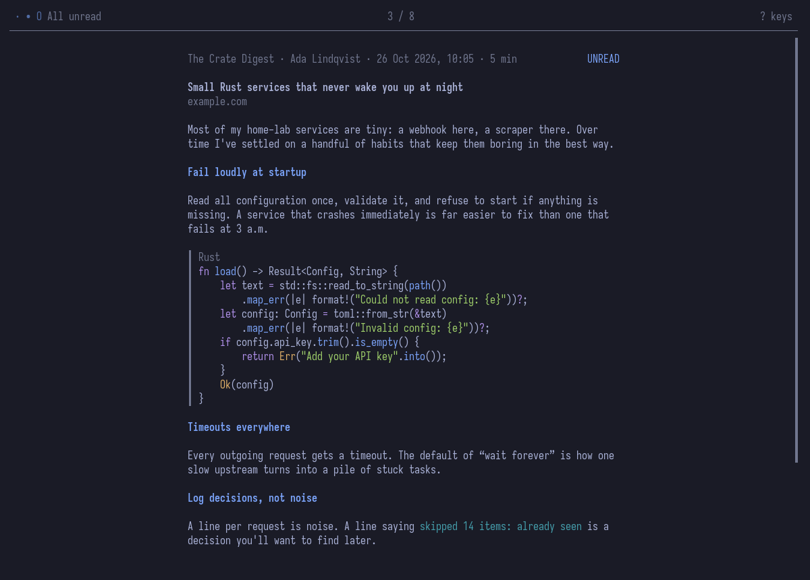
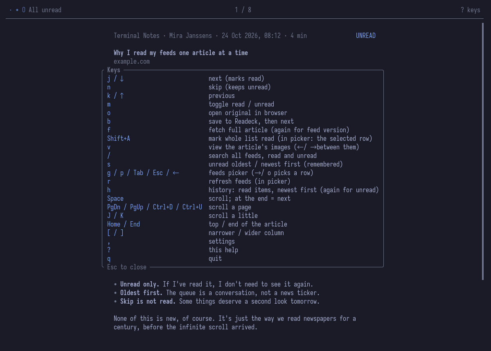

<p align="center">
  
</p>

<h1 align="center">Onward</h1>

<p align="center">
  <b>One unread article at a time. Oldest first. Keyboard all the way.</b><br>
  A small desktop reader for <a href="https://miniflux.app">Miniflux</a> or <a href="https://freshrss.org">FreshRSS</a>, for <a href="https://omarchy.org">Omarchy</a> and macOS, and for any terminal.
</p>

<p align="center">
  
  
  <a href="https://github.com/kletse/onward-rss-reader/releases/latest"></a>
  
  
  
</p>

---

## The idea

Most feed readers give you three panes and a wall of headlines. Onward shows **just the article**.

You pick a feed or category, and the app opens on the **oldest unread item**. Press **j** and it marks that item read and moves to the next one. When the list runs out, it asks the server once more for anything that arrived while you were reading. If nothing did, you get _“All caught up”_: **j** goes on to the next feed (or category) with unread items, and **Enter** takes you back to the feed picker.

<p align="center">
  
</p>

- **Unread first.** Read items don't appear, except ones you passed during this session, so **k** can take you back to undo.
- **History when you need it.** Press **h** to switch to the items you've already read, newest first, with all the same keys. Press **h** again to go back to unread.
- **Your feed server does the heavy lifting.** [Miniflux](https://miniflux.app), or over the Google Reader API, [FreshRSS](https://freshrss.org) or Miniflux's own Google Reader integration. It fetches the feeds and stores what you've read. The app is a thin client with no local database.
- **Follows your desktop live.** On Omarchy: colours, the UI font and window rounding update the moment you switch themes, or pick Onward Dark or Onward Light in **Settings** to keep the logo's colours instead. On macOS: light or dark mode, the moment you change it, along with the app icon.
- **Readeck in one key.** Press **b** to send the article to [Readeck](https://readeck.org), mark it read, and move on.
- **Star what you want to keep.** Press **\*** to star an article on your feed server; the **Starred** row in the picker reads them again, newest first.
- **In a terminal too.** `onward-tui` is the same reader filling your terminal, on Linux and macOS, locally or over SSH. See [In a terminal](#in-a-terminal).
- **Native, no web view.** The window is Qt Quick on Linux and SwiftUI on macOS, over the same Rust core: articles are laid out as native text and images, not in a browser engine.

## Screenshots

### Omarchy

| Reading an article                                                                       | Feeds picker                                                                                                                 | Code, highlighted in theme colours                                                                          |
| ---------------------------------------------------------------------------------------- | ---------------------------------------------------------------------------------------------------------------------------- | ----------------------------------------------------------------------------------------------------------- |
|      |                                  |  |
| **Keys (<kbd>?</kbd>)**                                                                  | **First-run setup**                                                                                                          |                                                                                                             |
|  |  |                                                                                                             |

### In a terminal

| Feeds picker                                                                                     | An article, in the terminal's own colours                                                                      | Keys (<kbd>?</kbd>)                                                                     |
| ------------------------------------------------------------------------------------------------ | ---------------------------------------------------------------------------------------------------------- | --------------------------------------------------------------------------------------- |
|  |  |  |

<sub>Screenshots use the built-in demo data (`ONWARD_DEMO=1`): Omarchy with the Tokyo Night theme, and the terminal version in foot with the same colours. The colours follow the active theme on Omarchy, the system appearance on macOS, and the terminal's palette in a terminal.</sub>

## Keys

| Key                                                                          | Action                                                                                                           |
| ---------------------------------------------------------------------------- | ---------------------------------------------------------------------------------------------------------------- |
| <kbd>j</kbd> / <kbd>↓</kbd>                                                  | Next article (**marks read**)                                                                                    |
| <kbd>n</kbd>                                                                 | Skip: next article, **keep unread**                                                                              |
| <kbd>k</kbd> / <kbd>↑</kbd>                                                  | Previous article                                                                                                 |
| <kbd>m</kbd>                                                                 | Toggle read / unread                                                                                             |
| <kbd>*</kbd>                                                                 | Star / unstar the article                                                                                        |
| <kbd>Space</kbd> / <kbd>Shift</kbd>+<kbd>Space</kbd>                         | Scroll down / up; <kbd>Space</kbd> at the end of an article goes to the next one                                 |
| <kbd>o</kbd>                                                                 | Open the original in your browser                                                                                |
| <kbd>b</kbd>                                                                 | Save to Readeck, mark read, go to the next article                                                               |
| <kbd>f</kbd>                                                                 | Fetch the full article (Miniflux's scraper); again for the feed's version                                        |
| <kbd>Shift</kbd>+<kbd>A</kbd>                                                | Mark the whole list read, but not what arrived since you opened it (asks first); in the picker, the selected row |
| <kbd>/</kbd>                                                                 | Search all feeds, read and unread                                                                                |
| <kbd>v</kbd>                                                                 | View the article's images, full window (<kbd>←</kbd> / <kbd>→</kbd> between them)                                |
| <kbd>s</kbd>                                                                 | Unread items oldest first or newest first (remembered)                                                           |
| <kbd>g</kbd> / <kbd>p</kbd> / <kbd>Tab</kbd> / <kbd>Esc</kbd> / <kbd>←</kbd> | Feeds & categories picker (all but <kbd>←</kbd> also close it)                                                   |
| <kbd>r</kbd>                                                                 | Refresh all feeds (in the picker)                                                                                |
| <kbd>h</kbd>                                                                 | Switch between unread and history (read items, newest first)                                                     |
| <kbd>Ctrl</kbd> <kbd>+</kbd> / <kbd>−</kbd>                                  | Article font size; the column width scales with it (remembered)                                                  |
| <kbd>[</kbd> / <kbd>]</kbd>                                                  | Narrower / wider column (remembered)                                                                             |
| <kbd>Ctrl</kbd> <kbd>0</kbd>                                                 | Reset font size and width                                                                                        |
| <kbd>,</kbd>                                                                 | Settings                                                                                                         |
| <kbd>?</kbd>                                                                 | Show the keys                                                                                                    |
| <kbd>q</kbd>                                                                 | Quit                                                                                                             |

On macOS the modifier is <kbd>⌘</kbd> instead of <kbd>Ctrl</kbd>.

The picker lists **All unread**, then **Starred**, then each category with its feeds underneath, with unread counts. Anything with nothing unread is hidden. Move with <kbd>j</kbd>/<kbd>k</kbd> and open with <kbd>Enter</kbd>, <kbd>→</kbd> or <kbd>o</kbd>. The logo at the top left opens it too, and its buttons do what the keys do: **Unread** and **History**, refresh and search at the top; the order, the keys and the settings at the bottom. Items load a page at a time as you read, so even a long **All unread** opens straight away; the top bar still counts all of them.

Press <kbd>Shift</kbd>+<kbd>A</kbd> in the picker to mark the selected feed or category read without opening it. It asks first, and, as in the reader, leaves alone what arrives after it counted.

Press <kbd>h</kbd> (or **History** at the top of the picker) to switch the picker to history: **All read**, categories and feeds with read counts. What you open there shows read items newest first, loaded a page at a time as you go, and a **History** badge appears in the top bar. Every key works the same: <kbd>m</kbd> marks an item unread again, <kbd>b</kbd> saves it to Readeck, and so on. <kbd>Esc</kbd> closes the picker without switching, so you're back where you were.

Press <kbd>*</kbd> to star the article on your feed server, or unstar it; a star in the top bar says it is. The **Starred** row, in the picker and in its history, lists the starred items newest first, read and unread, with a **Starred** badge in the top bar, and every key works there too: <kbd>j</kbd> marks one read and moves on, <kbd>*</kbd> unstars it (it stays in the list until you leave), and <kbd>Shift</kbd>+<kbd>A</kbd> only says it can't mark them all read.

Press <kbd>/</kbd> to search, from the reader or the picker. Miniflux looks through every feed, read and unread items alike, and the results open as a list like any other, best match first, with a **Search** badge in the top bar: <kbd>j</kbd> marks a result read and moves on, <kbd>m</kbd> toggles it, <kbd>b</kbd> saves it. <kbd>/</kbd> again starts from your last search.

Unread items come oldest first, so you read them in the order they were written. Press <kbd>s</kbd> (or the button at the bottom of the picker) to read the newest first instead; the app remembers. New arrivals still follow on at the end. History is always newest first.

Press <kbd>v</kbd>, or click an image, to see the article's images one at a time over the whole window. <kbd>←</kbd> / <kbd>→</kbd> go between them, <kbd>o</kbd> opens the one on screen (or the link it's in) in your browser, and <kbd>Esc</kbd>, <kbd>Space</kbd> or a click closes the viewer.

## Install

### Arch / Omarchy

**From a release** (quickest): download `onward-<version>-x86_64.pkg.tar.zst` from [Releases](https://github.com/kletse/onward-rss-reader/releases) and run

```bash
sudo pacman -U onward-*-x86_64.pkg.tar.zst
```

**From source**, on Arch / Omarchy with `rust` (or `rustup` and `lld`) and Qt 6 (`qt6-base qt6-declarative qt6-svg qt6-imageformats`):

```bash
git clone https://github.com/kletse/onward-rss-reader.git
cd onward-rss-reader/packaging
makepkg -si
```

This installs `/usr/bin/onward`, `/usr/bin/onward-tui` (see [In a terminal](#in-a-terminal)), a launcher entry (open it with <kbd>Super</kbd>+<kbd>Space</kbd> → _Onward_) and the icon. To uninstall, run `sudo pacman -R onward`.

Onward was called Kletse RSS until 5.2. The package replaces `kletse-rss`, so say yes when pacman asks, and your servers and preferences come over by themselves on the first run.

### macOS

There's no macOS download: build it from source, it takes a few minutes. On the Mac the app is native SwiftUI over the same Rust core, so it needs no Qt: the whole app is under 10 MB, and needs macOS 15 or later.

You need Xcode or its command line tools (`xcode-select --install`) and a current stable [Rust](https://rustup.rs).

```bash
git clone https://github.com/kletse/onward-rss-reader.git
cd onward-rss-reader
packaging/macos/build-app.sh
cp -r "packaging/Onward.app" /Applications/
```

Open it from Spotlight or the Dock. The window title, shown in Mission Control and the Window menu, is the article you're reading, and the toolbar shows where you are in the list. The feeds picker, the keys and the search box float over the article: click beside them to close them. Settings is a window of its own, so the reader keeps working behind it. Text is set in New York, headings in SF, code in SF Mono, and scrolling is the system's own. Size and position are remembered between launches. The app follows the system light/dark mode, in the colours of its logo, and on macOS 26 or later the Dock icon follows too. **Settings** has an orange icon, and the original look with your system accent colour, if you prefer them. The **Article** menu has the reading actions, and the usual <kbd>⌘</kbd><kbd>Q</kbd>, <kbd>⌘</kbd><kbd>W</kbd>, <kbd>⌘</kbd><kbd>M</kbd>, <kbd>⌘</kbd><kbd>H</kbd> and <kbd>⌘</kbd><kbd>,</kbd> work.

**Updating from source:** pull, rebuild, and replace the copy in `/Applications` (quit the app first, otherwise macOS keeps running the old binary):

```bash
git pull
packaging/macos/build-app.sh
rm -rf "/Applications/Onward.app"
cp -r "packaging/Onward.app" /Applications/
```

Your settings live outside the app bundle (see [Set up](#set-up)), so replacing it keeps them. Coming from Kletse RSS, delete `/Applications/Kletse RSS.app` as well: Onward picks up your servers and preferences by itself on its first run. To uninstall, delete `/Applications/Onward.app` and, if you want, `~/Library/Application Support/onward`.

## In a terminal

`onward-tui` is the same app without a window: it fills the terminal, and gives it back as it was when you quit. It needs neither Qt nor a desktop, so it also runs over SSH. It shares your [settings](#set-up) and everything you've read with the window, because your feed server keeps track of that.

**Install.** With a current stable [Rust](https://rustup.rs), on Linux or macOS:

```bash
git clone https://github.com/kletse/onward-rss-reader.git
cd onward-rss-reader
cargo install --path . --no-default-features --features tui --locked
```

That puts `onward-tui` in `~/.cargo/bin`. The Arch package installs it as well, as `/usr/bin/onward-tui`, and each release has a `onward-tui-<version>-x86_64` binary.

**Keys.** The same as the window, with these differences, which <kbd>?</kbd> shows too:

| Key                                                                        | Action                                                          |
| -------------------------------------------------------------------------- | --------------------------------------------------------------- |
| <kbd>PgDn</kbd> / <kbd>PgUp</kbd>, <kbd>Ctrl</kbd>+<kbd>D</kbd> / <kbd>U</kbd> | Scroll a page. Most terminals can't tell <kbd>Shift</kbd>+<kbd>Space</kbd> from <kbd>Space</kbd>, so these go up |
| <kbd>J</kbd> / <kbd>K</kbd>                                                | Scroll a little                                                 |
| <kbd>Home</kbd> / <kbd>End</kbd>                                           | Top / end of the article                                        |
| <kbd>Ctrl</kbd>+<kbd>L</kbd>                                               | Draw the screen again                                           |
| <kbd>Ctrl</kbd>+<kbd>C</kbd>                                               | Quit, from anywhere                                             |

Font size is your terminal's business, so the app has no keys for it. <kbd>[</kbd> and <kbd>]</kbd> set the column width, shared with the window.

**The mouse.** The wheel scrolls, and a click opens a link, an image or a picker row. The app has the mouse to do that, so to select text hold <kbd>Shift</kbd> while you drag (<kbd>⌥</kbd> in iTerm2).

**Colours** are your terminal's own, so it follows your theme, dark or light, on Omarchy and on macOS. Code blocks are plain text here: only the windows colour them.

**Images** appear in the article, as in the window: at their natural size, no wider than the column, and those of the next article load ahead. Press <kbd>v</kbd>, or click one, to see it full screen. Terminals with sixel, kitty or iTerm2 graphics (foot, Ghostty, kitty, WezTerm, iTerm2) show the image itself; others, such as Alacritty and Terminal, and anything inside tmux, draw it in half-block characters. JPEG, PNG, GIF and WebP work. An SVG or AVIF stays a line in the article, `▣` and its description: open that with <kbd>v</kbd>, then <kbd>o</kbd> for your browser.

## Set up

The first time you start Onward, it offers three things:

- **Try it with sample articles.** Built-in feeds, no account and no network. Nothing is marked read or saved, and the next start is a fresh one. The top bar says these are samples, with a way to Connect.
- **Connect**, which starts from your server's address.
- **I don't have a server.** Two ways to get one, with what they cost and [the catch](https://onward.kletse.dev/no-server/).

Arrows and <kbd>Enter</kbd> choose, as does the mouse in a window, and <kbd>Esc</kbd> steps back.

### Connect

Type the address you open in your browser, and press <kbd>Enter</kbd>. `rss`, `rss.example.com`, `host:8080`, a path such as `rss.example.com/miniflux`, or a page copied from the address bar will all do, and so will a Tailscale short name. Onward tries `https://` first, and plain `http://` only on local and tailnet addresses, where it says so. It works out what's there, with no sign-in, and asks only for what that server needs:

| Server | What it asks |
| ------ | ------------ |
| **Miniflux** | Your username and password, once. Onward gets a key of its own from your server and keeps that; the password isn't stored. |
| **Miniflux that can't do that** | If you sign in some other way (Google, OpenID Connect, a passkey), or it's older than 2.2.9, you make an API key on its page and paste it. **I don't sign in with a password** is always there, and opens that page. |
| **FreshRSS** | Your username and its **API password**, which isn't your login password. In FreshRSS: Settings → Profile → External access via API. If its API is off, Onward says so and where to turn it on (Settings → Authentication → Allow API access), and opens FreshRSS at its sign-in page, as its deeper pages show a 403 until you've signed in. |

Onward tells a sign-in page in front of the server from a wrong server, says so when a proxy removes the `Authorization` header, and names the servers it recognises but can't read yet, such as CommaFeed, yarr, selfoss, Tiny Tiny RSS and Nextcloud. It trusts public certificates only: a private CA or a self-signed certificate gets a message saying so.

**Enter the details yourself** has the whole form, for anything detection can't reach. It's how to use Miniflux's Google Reader integration: the server URL, and the username and password you set for it under Settings → Integrations. For FreshRSS the URL ends in `/api/greader.php`.

Connecting checks everything against your server before saving, so nothing wrong is ever written down.

Later, **Settings** has the same form, to edit directly, and **Find my server by its address** to go through this again.

Readeck is optional, and lives in **Settings**, which is **Settings** in the feeds picker, or <kbd>,</kbd>. It needs a URL and an API token (in Readeck: Profile → API Tokens, with the **Bookmarks: write** permission). Leave both empty and the bookmark button is hidden. It never stops the feed server being saved: if its details fail, a message says why, and the Readeck you had stays.

The settings are stored in `~/.config/onward/config.toml` on Linux and `~/Library/Application Support/onward/config.toml` on macOS (mode `600`), which you can also edit by hand:

```toml
[miniflux]
url = "https://miniflux.example.com"
api_key = "…"

[readeck]          # optional
url = "https://readeck.example.com"
token = "…"
```

Or, for a Google Reader API server, a `[greader]` section instead of `[miniflux]`:

```toml
server = "greader"   # only needed when both sections are filled in; otherwise the complete one is used

[greader]
url = "https://freshrss.example.com/api/greader.php"
username = "…"
password = "…"     # FreshRSS: the API password, not the one you log in with
```

**What a Google Reader API server can't do.** The protocol has no way to ask for a few things, so with one:

- <kbd>f</kbd> (fetch the full article) and <kbd>r</kbd> (refresh the feeds) only say they aren't available; the server refreshes feeds on its own schedule.
- <kbd>/</kbd> doesn't work: neither FreshRSS nor Miniflux's integration offers search through this API, and the app says so.
- History has no read counts, so the picker lists every feed there without a number.
- “Oldest first” is the order the server keeps: when items arrived on FreshRSS, when they were published on Miniflux.
- Miniflux's integration can't list a category's items (open its feeds one at a time) or give unread counts, and history per feed may show unread items left out.

## Develop

```bash
cargo run          # the app (ONWARD_DEMO=1 cargo run: with built-in sample data, no server needed)
cargo tui          # the terminal version, without Qt (ONWARD_DEMO=1 works here too)
cargo qt           # the Qt window by name: on a Mac with `brew install qt`, beside the native app
cargo test         # everything the app does, driven by key presses against a fake Miniflux; no Qt window needed
cargo clippy --all-targets -- -D warnings
cargo fmt
cargo build --release   # → target/release/onward
```

You need Rust and Qt 6 (see [Install](#install)); `qmake6` (or `qmake`) must be on the `PATH`, which is how the build finds Qt.

**How it fits together.** All behaviour lives in `src/app.rs`: a state machine that never waits. An action (a key, a click) changes the state and returns the server calls it needs; their answers come back later and are applied in turn. That is what the tests drive, with a fake Miniflux that shuffles items published in the same second, as Postgres does. `src/bridge.rs` is the one object the QML sees: it runs those calls on a small tokio runtime, and after every change copies what the window shows into properties. The QML (`qml/`) only draws and forwards keys and clicks.

**Agents and contributors:** [AGENTS.md](AGENTS.md) has the practical side: how to see the QML's errors, take screenshots without a window, and the traps found so far.

CI runs fmt, clippy and the tests on Arch Linux and macOS, a `cargo audit`, and a smoke test that renders several screens of the demo and of first run offscreen with every QML warning made fatal.

**Releasing:** bump the version in `Cargo.toml` (then `cargo build`, to update `Cargo.lock`) and `packaging/PKGBUILD`; `packaging/check-version.sh` (also run by CI and `release.sh`) checks they agree. Push it to `main`, write the notes, and run `packaging/release.sh NOTES.md`. It creates a draft release and pushes the tag; GitHub Actions (`release.yml`) builds the Arch package and the Linux binary on a native x86_64 runner and attaches them, and the script publishes the release once that build succeeds. It needs `gh`. Releases have no macOS app; Mac users build from source. To build the Linux downloads locally without releasing, run `packaging/build-linux-docker.sh` (Docker).

**Demo mode:** start with `ONWARD_DEMO=1` to go straight to the built-in sample feeds and articles (`src/demo.rs`), the ones the first screen offers. Nothing is marked read or saved, not even the font size, and unlike the first screen's choice it has no way out to Connect. It's handy for UI work and screenshots.

```text
src/
  main.rs            starts Qt and loads the QML
  app.rs             everything the app does: queue, paging, picker, overlays, settings, keys (no Qt, no network)
  app_tests.rs       its tests: key presses against a fake Miniflux
  bridge.rs          the QObject the QML sees; runs effects on tokio, copies state into properties
  ffi.rs             the same for Swift: the C interface the Mac app links
  tui_main.rs, tui/  the terminal version: runs effects, keeps the scroll position, draws cells (ratatui)
  backend.rs         the server side of effects: the feed server, Readeck, the config file, opening links
  keys.rs            the keymaps and the help overlay's text, checked against each other and the README
  paging.rs          where the next page starts (a publication time, not an offset)
  picker.rs          feed counts → picker rows
  prefs.rs           font size, column width and the order of unread items, remembered
  content/convert.rs feed HTML → blocks of native layout (paragraphs, images, code, quotes, lists, tables, embeds)
  content/highlight.rs  code blocks highlighted with syntect, in theme colours (windows only)
  content/native.rs  the blocks' inline HTML → styled runs, for Swift and the terminal
  theme/             the Omarchy theme (watched live), the macOS appearance or the logo's colours, as a palette
  feeds.rs           what every feed server deals in: entries, feeds, counts, selections
  server.rs          the feed server: Miniflux or a Google Reader API server, one set of calls
  miniflux.rs        Miniflux API client
  greader.rs         Google Reader API client (FreshRSS, Miniflux's integration)
  readeck.rs         Readeck "save bookmark"
  config.rs          ~/.config/onward/config.toml (macOS: ~/Library/Application Support/onward/)
  moved.rs           moves the kletse-rss folders to onward on first use
  demo.rs            sample data, for the first screen and ONWARD_DEMO=1
  detect.rs          the forgiving address box, and what's at that address
  providers.rs       the kinds of server, their fields and first run's words, which the windows draw from
qml/                 the window: Main, TopBar, Reader, Article, Blocks, RichText, Picker, Help, Confirm, Toast, Settings, Onboarding, ServerForm
macos/               the Mac app: SwiftUI over the same core
assets/fonts/        Literata and Inter (SIL Open Font License), compiled into the binary
packaging/           PKGBUILD, .desktop entry, icon, macOS app bundle script, release scripts
```

### How it handles articles

- Article HTML is turned into native blocks: paragraphs, headings, images with captions, code, quotes, lists, tables and rules. Only a small set of tags and attributes makes it through, so scripts, styles, forms and tracking attributes are gone, and nothing in an article can run.
- Iframes, videos and audio become a plain _▶ Embedded media_ link. Inline SVG and MathML aren't shown (run with `ONWARD_DEBUG=1` to see on stderr when an article had some).
- Images load (through Miniflux's media proxy if you have it enabled). While you read, the next article is already converted and its images loaded, so <kbd>j</kbd> doesn't wait for them.
- Every link opens in your default browser, never inside the app.
- Code blocks are highlighted with syntect using the theme's own colours, in the windows. The terminal version leaves it out and shows them plain, which keeps its binary smaller.
- Text can be selected within a paragraph, and <kbd>Ctrl</kbd>+<kbd>C</kbd> (<kbd>⌘</kbd><kbd>C</kbd>) copies it.

## Not (yet) in scope

Managing feeds (use your server's web UI), offline reading, notifications and a bar widget.

## License

[MIT](LICENSE)
