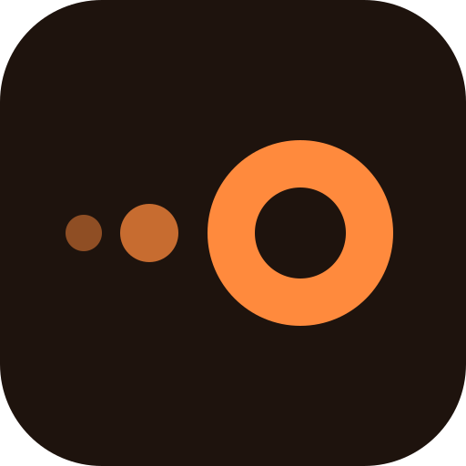
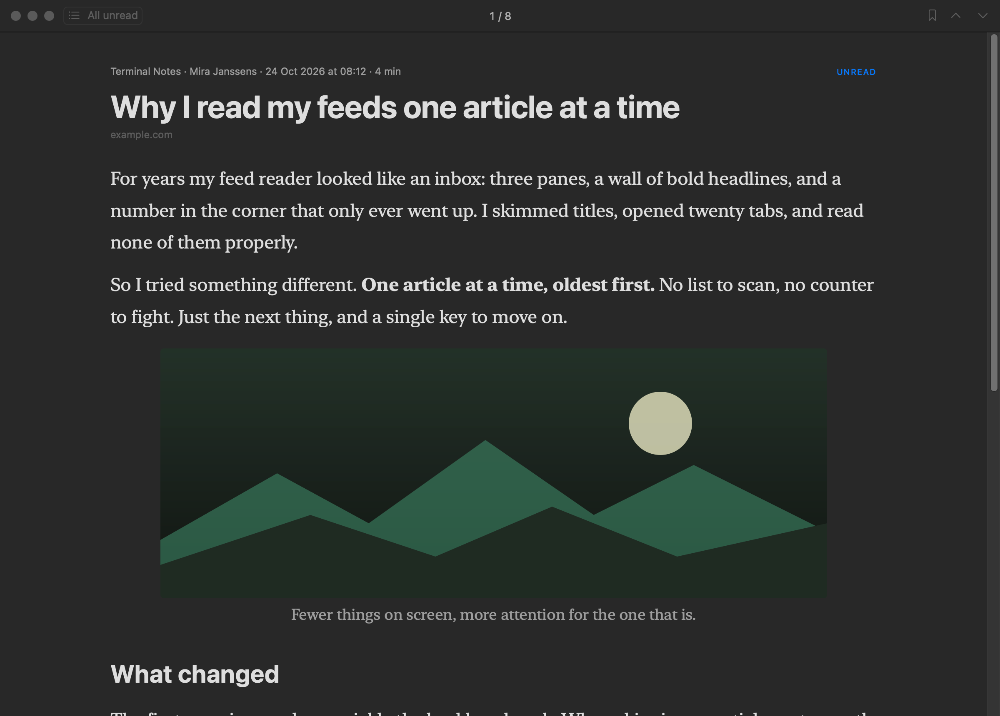
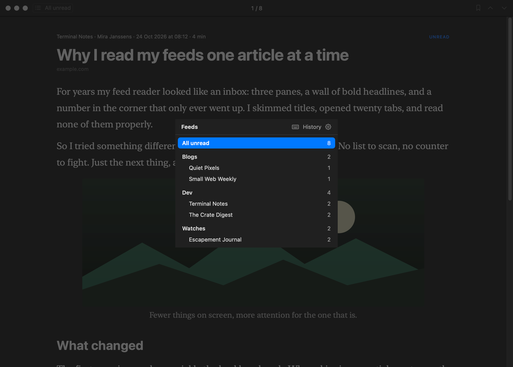
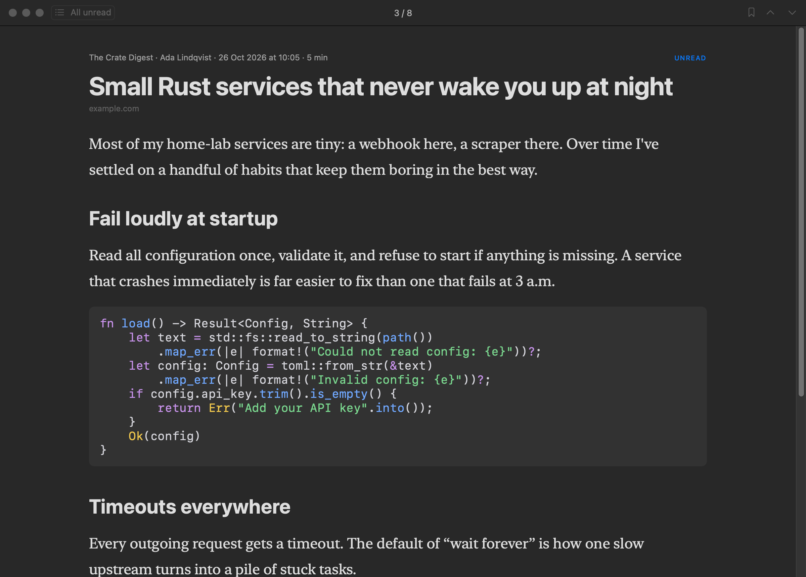
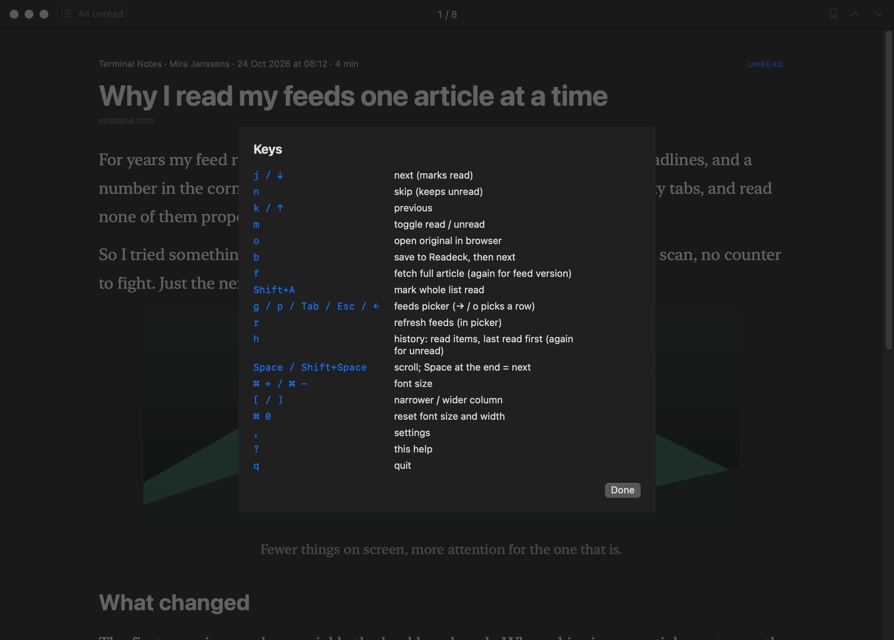
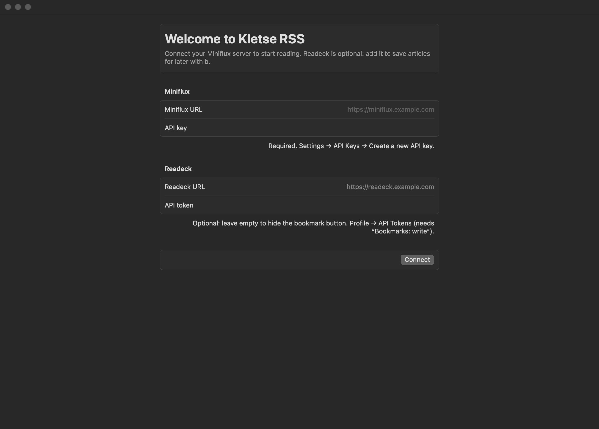

<p align="center">
  
</p>

<h1 align="center">Kletse RSS</h1>

<p align="center">
  <b>One unread article at a time. Oldest first. Keyboard all the way.</b><br>
  A small desktop reader for <a href="https://miniflux.app">Miniflux</a>, for <a href="https://omarchy.org">Omarchy</a> and macOS.
</p>

<p align="center">
  
  
  <a href="https://github.com/kletse/kletse-rss-reader/releases/latest"></a>
  
  
  
</p>

---

## The idea

Most feed readers give you three panes and a wall of headlines. Kletse RSS shows **just the article**.

You pick a feed or category, and the app opens on the **oldest unread item**. Press **j** and it marks that item read and moves to the next one. When the list runs out, it asks Miniflux once more for anything that arrived while you were reading. If nothing did, you get _“All caught up”_: **j** goes on to the next feed (or category) with unread items, and **Enter** takes you back to the feed picker.

<p align="center">
  
</p>

- **Unread first.** Read items don't appear, except ones you passed during this session, so **k** can take you back to undo.
- **History when you need it.** Press **h** to switch to the items you've already read, newest first, with all the same keys. Press **h** again to go back to unread.
- **Miniflux does the heavy lifting.** It fetches the feeds and stores what you've read. The app is a thin client with no local database.
- **Follows your desktop live.** On Omarchy: colours, the UI font and window rounding update the moment you switch themes. On macOS: light or dark mode and your accent colour, the moment you change them.
- **Readeck in one key.** Press **b** to send the article to [Readeck](https://readeck.org), mark it read, and move on.
- **Native, no web view.** The window is Qt Quick, driven from Rust: articles are laid out as native text and images, not in a browser engine.

## Screenshots

### macOS

| Feeds picker                                                                                                   | Code, highlighted in theme colours                                                             | Keys (<kbd>?</kbd>)                                                         |
| -------------------------------------------------------------------------------------------------------------- | ---------------------------------------------------------------------------------------------- | --------------------------------------------------------------------------- |
|                                 |  |  |
| **First-run setup**                                                                                            |                                                                                                |                                                                             |
|  |                                                                                                |                                                                             |

### Omarchy

| Reading an article                                                                       | Feeds picker                                                                                                                 | Code, highlighted in theme colours                                                                          |
| ---------------------------------------------------------------------------------------- | ---------------------------------------------------------------------------------------------------------------------------- | ----------------------------------------------------------------------------------------------------------- |
|      |                                  |  |
| **Keys (<kbd>?</kbd>)**                                                                  | **First-run setup**                                                                                                          |                                                                                                             |
|  |  |                                                                                                             |

<sub>Screenshots use the built-in demo data (`KLETSE_RSS_DEMO=1`): macOS in dark mode, Omarchy with the Tokyo Night theme. The colours follow the system appearance on macOS and the active theme on Omarchy.</sub>

## Keys

| Key                                                                          | Action                                                                                                           |
| ---------------------------------------------------------------------------- | ---------------------------------------------------------------------------------------------------------------- |
| <kbd>j</kbd> / <kbd>↓</kbd>                                                  | Next article (**marks read**)                                                                                    |
| <kbd>n</kbd>                                                                 | Skip: next article, **keep unread**                                                                              |
| <kbd>k</kbd> / <kbd>↑</kbd>                                                  | Previous article                                                                                                 |
| <kbd>m</kbd>                                                                 | Toggle read / unread                                                                                             |
| <kbd>Space</kbd> / <kbd>Shift</kbd>+<kbd>Space</kbd>                         | Scroll down / up; <kbd>Space</kbd> at the end of an article goes to the next one                                 |
| <kbd>o</kbd>                                                                 | Open the original in your browser                                                                                |
| <kbd>b</kbd>                                                                 | Save to Readeck, mark read, go to the next article                                                               |
| <kbd>f</kbd>                                                                 | Fetch the full article (Miniflux's scraper); again for the feed's version                                        |
| <kbd>Shift</kbd>+<kbd>A</kbd>                                                | Mark the whole list read, but not what arrived since you opened it (asks first); in the picker, the selected row |
| <kbd>/</kbd>                                                                 | Search all feeds, read and unread                                                                                |
| <kbd>v</kbd>                                                                 | View the article's images, full window (<kbd>←</kbd> / <kbd>→</kbd> between them)                                |
| <kbd>s</kbd>                                                                 | Unread items oldest first or newest first (remembered)                                                           |
| <kbd>g</kbd> / <kbd>p</kbd> / <kbd>Tab</kbd> / <kbd>Esc</kbd> / <kbd>←</kbd> | Feeds & categories picker (all but <kbd>←</kbd> also close it)                                                   |
| <kbd>r</kbd>                                                                 | Refresh all feeds (in the picker)                                                                                |
| <kbd>h</kbd>                                                                 | Switch between unread and history (read items, newest first)                                                     |
| <kbd>Ctrl</kbd> <kbd>+</kbd> / <kbd>−</kbd>                                  | Article font size; the column width scales with it (remembered)                                                  |
| <kbd>[</kbd> / <kbd>]</kbd>                                                  | Narrower / wider column (remembered)                                                                             |
| <kbd>Ctrl</kbd> <kbd>0</kbd>                                                 | Reset font size and width                                                                                        |
| <kbd>,</kbd>                                                                 | Settings                                                                                                         |
| <kbd>?</kbd>                                                                 | Show the keys                                                                                                    |
| <kbd>q</kbd>                                                                 | Quit                                                                                                             |

On macOS the modifier is <kbd>⌘</kbd> instead of <kbd>Ctrl</kbd>.

The picker lists **All unread**, then each category with its feeds underneath, with unread counts. Anything with nothing unread is hidden. Move with <kbd>j</kbd>/<kbd>k</kbd> and open with <kbd>Enter</kbd>, <kbd>→</kbd> or <kbd>o</kbd>. Items load a page at a time as you read, so even a long **All unread** opens straight away; the top bar still counts all of them.

Press <kbd>Shift</kbd>+<kbd>A</kbd> in the picker to mark the selected feed or category read without opening it. It asks first, and, as in the reader, leaves alone what arrives after it counted.

Press <kbd>h</kbd> (or the **History** button) to switch the picker to history: **All read**, categories and feeds with read counts. What you open there shows read items newest first, loaded a page at a time as you go, and a **History** badge appears in the top bar. Every key works the same: <kbd>m</kbd> marks an item unread again, <kbd>b</kbd> saves it to Readeck, and so on. <kbd>Esc</kbd> closes the picker without switching, so you're back where you were.

Press <kbd>/</kbd> to search, from the reader or the picker. Miniflux looks through every feed, read and unread items alike, and the results open as a list like any other, best match first, with a **Search** badge in the top bar: <kbd>j</kbd> marks a result read and moves on, <kbd>m</kbd> toggles it, <kbd>b</kbd> saves it. <kbd>/</kbd> again starts from your last search.

Unread items come oldest first, so you read them in the order they were written. Press <kbd>s</kbd> (or the button in the picker) to read the newest first instead; the app remembers. New arrivals still follow on at the end. History is always newest first.

Press <kbd>v</kbd>, or click an image, to see the article's images one at a time over the whole window. <kbd>←</kbd> / <kbd>→</kbd> go between them, <kbd>o</kbd> opens the one on screen (or the link it's in) in your browser, and <kbd>Esc</kbd>, <kbd>Space</kbd> or a click closes the viewer.

## Install

### Arch / Omarchy

**From a release** (quickest): download `kletse-rss-<version>-x86_64.pkg.tar.zst` from [Releases](https://github.com/kletse/kletse-rss-reader/releases) and run

```bash
sudo pacman -U kletse-rss-*-x86_64.pkg.tar.zst
```

**From source**, on Arch / Omarchy with `rust` (or `rustup` and `lld`) and Qt 6 (`qt6-base qt6-declarative qt6-svg qt6-imageformats`):

```bash
git clone https://github.com/kletse/kletse-rss-reader.git
cd kletse-rss-reader/packaging
makepkg -si
```

This installs `/usr/bin/kletse-rss`, a launcher entry (open it with <kbd>Super</kbd>+<kbd>Space</kbd> → _Kletse RSS_) and the icon. To uninstall, run `sudo pacman -R kletse-rss`.

### macOS

There's no macOS download: build it from source, it takes a few minutes. On the Mac the app is native SwiftUI over the same Rust core, so it needs no Qt: the whole app is under 10 MB, and needs macOS 15 or later.

You need Xcode or its command line tools (`xcode-select --install`) and a current stable [Rust](https://rustup.rs).

```bash
git clone https://github.com/kletse/kletse-rss-reader.git
cd kletse-rss-reader
packaging/macos/build-app.sh
cp -r "packaging/Kletse RSS.app" /Applications/
```

Open it from Spotlight or the Dock. The window title, shown in Mission Control and the Window menu, is the article you're reading, and the toolbar shows where you are in the list. The feeds picker and the keys open as sheets. Text is set in New York, headings in SF, code in SF Mono, and scrolling is the system's own. Size and position are remembered between launches. The app follows the system light/dark mode and accent colour, the **Article** menu has the reading actions, and the usual <kbd>⌘</kbd><kbd>Q</kbd>, <kbd>⌘</kbd><kbd>W</kbd>, <kbd>⌘</kbd><kbd>M</kbd>, <kbd>⌘</kbd><kbd>H</kbd> and <kbd>⌘</kbd><kbd>,</kbd> work.

**Updating from source:** pull, rebuild, and replace the copy in `/Applications` (quit the app first, otherwise macOS keeps running the old binary):

```bash
git pull
packaging/macos/build-app.sh
rm -rf "/Applications/Kletse RSS.app"
cp -r "packaging/Kletse RSS.app" /Applications/
```

Your settings live outside the app bundle (see [Set up](#set-up)), so replacing it keeps them. To uninstall, delete `/Applications/Kletse RSS.app` and, if you want, `~/Library/Application Support/kletse-rss`.

## Set up

The first time you start Kletse RSS, a welcome screen asks for:

|                             |                                                                                                                                             |
| --------------------------- | ------------------------------------------------------------------------------------------------------------------------------------------- |
| **Miniflux URL + API key**  | _Required._ In Miniflux: Settings → API Keys → Create a new API key.                                                                        |
| **Readeck URL + API token** | _Optional._ In Readeck: Profile → API Tokens, with the **Bookmarks: write** permission. Leave both empty and the bookmark button is hidden. |

**Connect** checks the details against your servers before saving anything, so a wrong key or address shows up right there. You can change them later with **Settings** in the feeds picker, or by pressing <kbd>,</kbd>.

The settings are stored in `~/.config/kletse-rss/config.toml` on Linux and `~/Library/Application Support/kletse-rss/config.toml` on macOS (mode `600`), which you can also edit by hand:

```toml
[miniflux]
url = "https://miniflux.example.com"
api_key = "…"

[readeck]          # optional
url = "https://readeck.example.com"
token = "…"
```

## Develop

```bash
cargo run          # the app (KLETSE_RSS_DEMO=1 cargo run: with built-in sample data, no server needed)
cargo test         # everything the app does, driven by key presses against a fake Miniflux; no Qt window needed
cargo clippy --all-targets -- -D warnings
cargo fmt
cargo build --release   # → target/release/kletse-rss
```

You need Rust and Qt 6 (see [Install](#install)); `qmake6` (or `qmake`) must be on the `PATH`, which is how the build finds Qt.

**How it fits together.** All behaviour lives in `src/app.rs`: a state machine that never waits. An action (a key, a click) changes the state and returns the server calls it needs; their answers come back later and are applied in turn. That is what the tests drive, with a fake Miniflux that shuffles items published in the same second, as Postgres does. `src/bridge.rs` is the one object the QML sees: it runs those calls on a small tokio runtime, and after every change copies what the window shows into properties. The QML (`qml/`) only draws and forwards keys and clicks.

**Agents and contributors:** [AGENTS.md](AGENTS.md) has the practical side: how to see the QML's errors, take screenshots without a window, and the traps found so far.

CI runs fmt, clippy and the tests on Arch Linux and macOS, a `cargo audit`, and a smoke test that renders several screens of the demo offscreen with every QML warning made fatal.

**Releasing:** bump the version in `Cargo.toml` (then `cargo build`, to update `Cargo.lock`) and `packaging/PKGBUILD`; `packaging/check-version.sh` (also run by CI and `release.sh`) checks they agree. Push it to `main`, write the notes, and run `packaging/release.sh NOTES.md`. It creates a draft release and pushes the tag; GitHub Actions (`release.yml`) builds the Arch package and the Linux binary on a native x86_64 runner and attaches them, and the script publishes the release once that build succeeds. It needs `gh`. Releases have no macOS app; Mac users build from source. To build the Linux downloads locally without releasing, run `packaging/build-linux-docker.sh` (Docker).

**Demo mode:** start with `KLETSE_RSS_DEMO=1` to use built-in sample feeds and articles (`src/demo.rs`) instead of Miniflux. Nothing is marked read or saved, not even the font size. It's handy for UI work and screenshots.

```text
src/
  main.rs            starts Qt and loads the QML
  app.rs             everything the app does: queue, paging, picker, overlays, settings, keys (no Qt, no network)
  app_tests.rs       its tests: key presses against a fake Miniflux
  bridge.rs          the QObject the QML sees; runs effects on tokio, copies state into properties
  backend.rs         the server side of effects: Miniflux, Readeck, the config file, opening links
  keys.rs            the keymaps and the help overlay's text, checked against each other and the README
  paging.rs          where the next page starts (a publication time, not an offset)
  picker.rs          feed counts → picker rows
  prefs.rs           font size, column width and the order of unread items, remembered
  content/convert.rs feed HTML → blocks of native layout (paragraphs, images, code, quotes, lists, tables, embeds)
  content/highlight.rs  code blocks highlighted with syntect, in theme colours
  theme/             the Omarchy theme (watched live) or the macOS appearance, as a palette
  miniflux.rs        Miniflux API client
  readeck.rs         Readeck "save bookmark"
  config.rs          ~/.config/kletse-rss/config.toml (macOS: ~/Library/Application Support/kletse-rss/)
  demo.rs            sample data for KLETSE_RSS_DEMO=1
qml/                 the window: Main, TopBar, Reader, Article, Blocks, RichText, Picker, Help, Confirm, Toast, Settings
assets/fonts/        Literata and Inter (SIL Open Font License), compiled into the binary
packaging/           PKGBUILD, .desktop entry, icon, macOS app bundle script, release scripts
```

### How it handles articles

- Article HTML is turned into native blocks: paragraphs, headings, images with captions, code, quotes, lists, tables and rules. Only a small set of tags and attributes makes it through, so scripts, styles, forms and tracking attributes are gone, and nothing in an article can run.
- Iframes, videos and audio become a plain _▶ Embedded media_ link. Inline SVG and MathML aren't shown (run with `KLETSE_RSS_DEBUG=1` to see on stderr when an article had some).
- Images load (through Miniflux's media proxy if you have it enabled). While you read, the next article is already converted and its images loaded, so <kbd>j</kbd> doesn't wait for them.
- Every link opens in your default browser, never inside the app.
- Code blocks are highlighted with syntect using the theme's own colours.
- Text can be selected within a paragraph, and <kbd>Ctrl</kbd>+<kbd>C</kbd> (<kbd>⌘</kbd><kbd>C</kbd>) copies it.

## Not (yet) in scope

Managing feeds (use the Miniflux web UI), starring, offline reading, notifications and a bar widget.

## License

[MIT](LICENSE)
