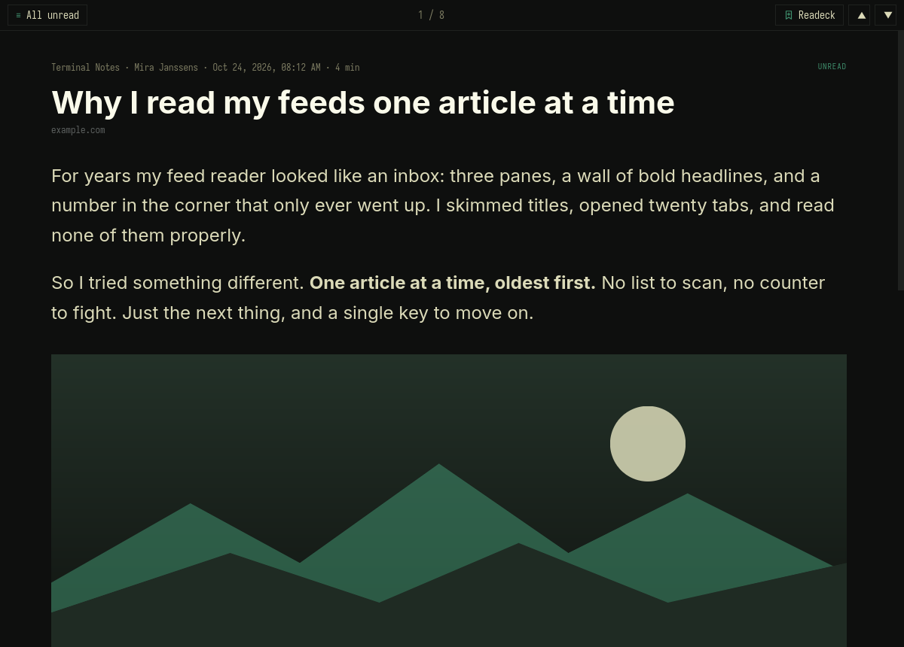
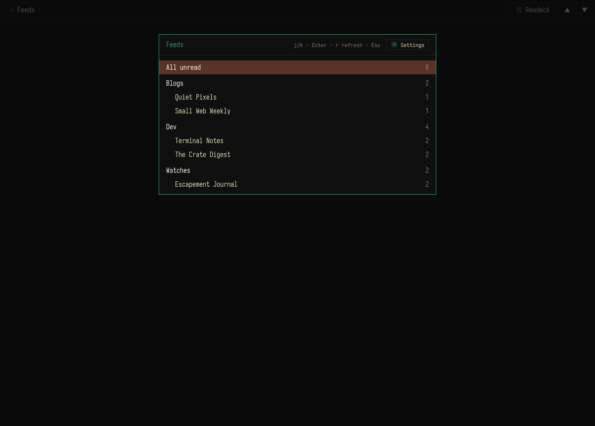
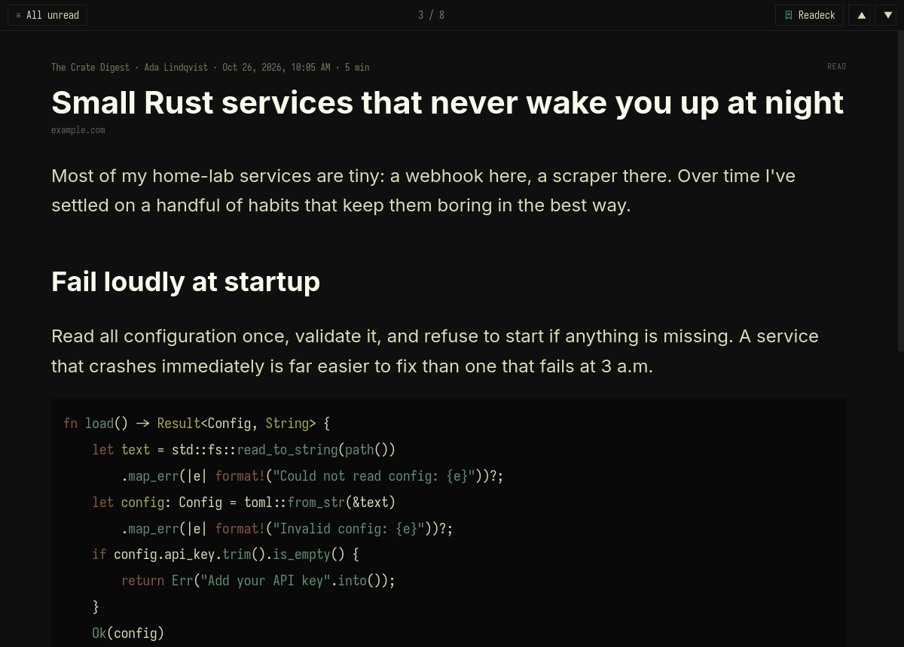
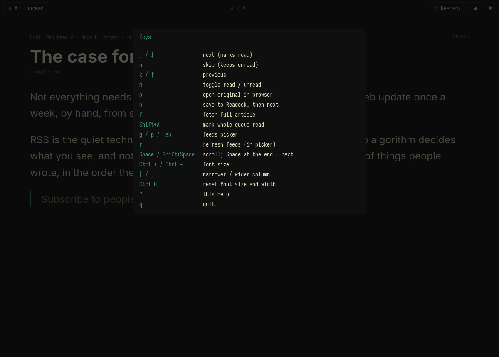
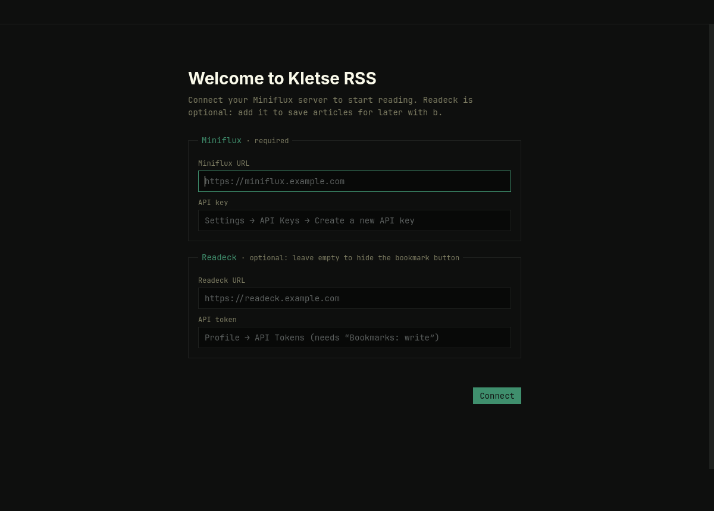

<p align="center">
  
</p>

<h1 align="center">Kletse RSS</h1>

<p align="center">
  <b>One unread article at a time. Oldest first. Keyboard all the way.</b><br>
  A small desktop reader for <a href="https://miniflux.app">Miniflux</a>, for <a href="https://omarchy.org">Omarchy</a> and macOS.
</p>

<p align="center">
  
  
  <a href="https://github.com/kletse/kletse-rss-reader/releases/latest"></a>
  
  
  
  
  
</p>

---

## The idea

Most feed readers give you three panes and a wall of headlines. Kletse RSS shows **just the article**.

You pick a feed or category, and the app opens on the **oldest unread item**. Press **j** and it marks that item read and moves to the next one. When the list runs out, you get _“All caught up”_ and you're back at the feed picker.

<p align="center">
  
</p>

- **Unread first.** Read items don't appear, except ones you passed during this session, so **k** can take you back to undo.
- **History when you need it.** Press **h** to switch to the items you've already read, newest first, with all the same keys. Press **h** again to go back to unread.
- **Miniflux does the heavy lifting.** It fetches the feeds and stores what you've read. The app is a thin client with no local database.
- **Follows your desktop live.** On Omarchy: colours, the UI font and window rounding update the moment you switch themes. On macOS: light or dark mode and your accent colour, the moment you change them.
- **Readeck in one key.** Press **b** to send the article to [Readeck](https://readeck.org), mark it read, and move on.

## Screenshots

| Feeds picker                                                                                             | Code, highlighted in theme colours                                                       | Keys (<kbd>?</kbd>)                                                   |
| -------------------------------------------------------------------------------------------------------- | ---------------------------------------------------------------------------------------- | --------------------------------------------------------------------- |
|                                 |  |  |
| **First-run setup**                                                                                      |                                                                                          |                                                                       |
|  |                                                                                          |                                                                       |

<sub>Screenshots use the built-in demo data (`KLETSE_RSS_DEMO=1`) with an Omarchy theme. The colours follow whichever theme you have active; on macOS they follow the system appearance.</sub>

## Keys

| Key                                                                          | Action                                                                           |
| ---------------------------------------------------------------------------- | -------------------------------------------------------------------------------- |
| <kbd>j</kbd> / <kbd>↓</kbd>                                                  | Next article (**marks read**)                                                    |
| <kbd>n</kbd>                                                                 | Skip: next article, **keep unread**                                              |
| <kbd>k</kbd> / <kbd>↑</kbd>                                                  | Previous article                                                                 |
| <kbd>m</kbd>                                                                 | Toggle read / unread                                                             |
| <kbd>Space</kbd> / <kbd>Shift</kbd>+<kbd>Space</kbd>                         | Scroll down / up; <kbd>Space</kbd> at the end of an article goes to the next one |
| <kbd>o</kbd>                                                                 | Open the original in your browser                                                |
| <kbd>b</kbd>                                                                 | Save to Readeck, mark read, go to the next article                               |
| <kbd>f</kbd>                                                                 | Fetch the full article (Miniflux's readability scraper)                          |
| <kbd>Shift</kbd>+<kbd>A</kbd>                                                | Mark everything in the current list read (asks first)                            |
| <kbd>g</kbd> / <kbd>p</kbd> / <kbd>Tab</kbd> / <kbd>Esc</kbd> / <kbd>←</kbd> | Feeds & categories picker (all but <kbd>←</kbd> also close it)                   |
| <kbd>r</kbd>                                                                 | Refresh all feeds (in the picker)                                                |
| <kbd>h</kbd>                                                                 | Switch between unread and history (read items, newest first)                     |
| <kbd>Ctrl</kbd> <kbd>+</kbd> / <kbd>−</kbd>                                  | Article font size; the column width scales with it (remembered)                  |
| <kbd>[</kbd> / <kbd>]</kbd>                                                  | Narrower / wider column (remembered)                                             |
| <kbd>Ctrl</kbd> <kbd>0</kbd>                                                 | Reset font size and width                                                        |

On macOS the modifier is <kbd>⌘</kbd> instead of <kbd>Ctrl</kbd>.
| <kbd>,</kbd> | Settings |
| <kbd>?</kbd> | Show the keys |
| <kbd>q</kbd> | Quit |

The picker lists **All unread**, then each category with its feeds underneath, with unread counts. Anything with nothing unread is hidden. Move with <kbd>j</kbd>/<kbd>k</kbd> and open with <kbd>Enter</kbd> or <kbd>→</kbd>.

Press <kbd>h</kbd> (or the **History** button) to switch the picker to history: **All read**, categories and feeds with read counts. What you open there shows read items newest first, loaded a page at a time as you go, and a **History** badge appears in the top bar. Every key works the same: <kbd>m</kbd> marks an item unread again, <kbd>b</kbd> saves it to Readeck, and so on. <kbd>Esc</kbd> closes the picker without switching, so you're back where you were.

## Install

### Arch / Omarchy

**From a release** (quickest): download `kletse-rss-<version>-x86_64.pkg.tar.zst` from [Releases](https://github.com/kletse/kletse-rss-reader/releases) and run

```bash
sudo pacman -U kletse-rss-*-x86_64.pkg.tar.zst
```

**From source**, on Arch / Omarchy with `rust` (or `rustup`), `npm`, and `webkit2gtk-4.1`:

```bash
git clone https://github.com/kletse/kletse-rss-reader.git
cd kletse-rss-reader/packaging
makepkg -si
```

This installs `/usr/bin/kletse-rss`, a launcher entry (open it with <kbd>Super</kbd>+<kbd>Space</kbd> → _Kletse RSS_) and the icon. To uninstall, run `sudo pacman -R kletse-rss`.

### macOS

**From a release** (quickest): download `Kletse-RSS-<version>-macos-universal.zip` from [Releases](https://github.com/kletse/kletse-rss-reader/releases) (Apple Silicon and Intel), unzip it and move **Kletse RSS.app** to `/Applications`. The app isn't signed by Apple, so macOS blocks it the first time. To allow it, run this once:

```bash
xattr -dr com.apple.quarantine "/Applications/Kletse RSS.app"
```

To update, quit the app, replace it with the new download and run the same command again.

**From source:** you need Xcode's command line tools (`xcode-select --install`), a current stable [Rust](https://rustup.rs) and Node.

```bash
git clone https://github.com/kletse/kletse-rss-reader.git
cd kletse-rss-reader
npm install
npm run build
cp -r "src-tauri/target/release/bundle/macos/Kletse RSS.app" /Applications/
```

Open it from Spotlight or the Dock. The window has no title bar: drag it by the top bar, double-click the bar to zoom. Size and position are remembered between launches. The app follows the system light/dark mode and accent colour, and the usual <kbd>⌘</kbd><kbd>Q</kbd>, <kbd>⌘</kbd><kbd>W</kbd>, <kbd>⌘</kbd><kbd>M</kbd> and <kbd>⌘</kbd><kbd>H</kbd> work.

**Updating from source:** pull, rebuild, and replace the copy in `/Applications` (quit the app first, otherwise macOS keeps running the old binary):

```bash
git pull
npm install
npm run build
rm -rf "/Applications/Kletse RSS.app"
cp -r "src-tauri/target/release/bundle/macos/Kletse RSS.app" /Applications/
```

Your settings live outside the app bundle (see [Set up](#set-up)), so replacing it keeps them. To uninstall, delete `/Applications/Kletse RSS.app` and, if you want, `~/Library/Application Support/kletse-rss`.

## Set up

The first time you start Kletse RSS, a welcome screen asks for:

|                             |                                                                                                                                             |
| --------------------------- | ------------------------------------------------------------------------------------------------------------------------------------------- |
| **Miniflux URL + API key**  | _Required._ In Miniflux: Settings → API Keys → Create a new API key.                                                                        |
| **Readeck URL + API token** | _Optional._ In Readeck: Profile → API Tokens, with the **Bookmarks: write** permission. Leave both empty and the bookmark button is hidden. |

**Connect** checks the details against your servers before saving anything, so a wrong key or address shows up right there. You can change them later with **Settings** in the feeds picker, or by pressing <kbd>,</kbd>.

The settings are stored in `~/.config/kletse-rss/config.toml` on Linux and `~/Library/Application Support/kletse-rss/config.toml` on macOS (mode `600`), which you can also edit by hand:

```toml
[miniflux]
url = "https://miniflux.example.com"
api_key = "…"

[readeck]          # optional
url = "https://readeck.example.com"
token = "…"
```

## Develop

```bash
npm install
npm run dev        # Tauri dev window with hot reload
npm run check      # type-check the UI
npm test           # UI unit and component tests (vitest + jsdom)
npm run lint       # Biome (UI lint + format check), then rustfmt --check and clippy on the backend
npm run format     # Biome and rustfmt: format and apply safe fixes
npm run build      # release binary → src-tauri/target/release/kletse-rss (macOS: also …/bundle/macos/Kletse RSS.app)
(cd src-tauri && cargo test)   # backend tests, with a mock Miniflux/Readeck
```

[Biome](https://biomejs.dev) lints and formats the UI code, CSS, JSON and Markdown: every stable rule plus the nursery ones, with the few that don't fit this stack switched off, each with its reason in `biome.jsonc`. TypeScript runs with `strict` and the extra checks in `tsconfig.json` (`noUncheckedIndexedAccess`, `exactOptionalPropertyTypes`, …). Editors: `.zed/settings.json` formats and fixes with Biome on save and runs clippy through rust-analyzer (install Zed's Biome extension); `.vscode/` does the same for VS Code.

CI runs the same checks plus `npm audit` and `cargo audit` on every push, with clippy and the Rust tests on both Linux and macOS.

**Release builds:** `packaging/release.sh [ref]` builds every download from a Mac into `packaging/release/`: the Arch package and the Linux binary in an x86_64 Arch Linux container (Docker; slow under emulation on Apple Silicon), and the universal macOS app. It builds what's committed at the ref (default `HEAD`). It needs Docker running and `rustup target add aarch64-apple-darwin x86_64-apple-darwin`.

**Demo mode:** start with `KLETSE_RSS_DEMO=1` to use built-in sample feeds and articles (`src-tauri/src/demo.rs`) instead of Miniflux. Nothing is marked read or saved. It's handy for UI work and screenshots:

```bash
KLETSE_RSS_DEMO=1 npm run dev
```

```text
src/                 TypeScript UI (SolidJS)
  state/             app state (signals) and actions
    queue.ts         the reading queue, history paging, article actions
    picker.ts        the feeds picker
    settings.ts      settings, onboarding, start-up
    prefs.ts         font size and column width
    ui.ts            overlays, toast, confirm, scrolling
    server.ts        what the backend reported (Readeck set up)
  App.tsx            layout and link clicks
  keyboard.ts        the single keyboard handler: a keymap per mode
  components/        top bar, article, picker, settings form, help/confirm/toast
  picker-items.ts    feed counts → picker rows
  keys.ts            key reference and platform modifier
  content.ts         sanitising article HTML, embeds → links, code highlighting
  theme.ts           theme palette → CSS variables, live
  api.ts             typed wrappers for the Rust commands
  *.test.ts(x)       vitest unit and UI tests
src-tauri/src/
  lib.rs             Tauri commands
  miniflux.rs        Miniflux API client
  readeck.rs         Readeck "save bookmark"
  theme/omarchy.rs   reads ~/.local/state/omarchy/current/theme/colors.toml, watches for switches
  theme/macos.rs     light/dark mode and accent colour from System Settings, follows changes
  config.rs          ~/.config/kletse-rss/config.toml (macOS: ~/Library/Application Support/kletse-rss/)
  demo.rs            sample data for KLETSE_RSS_DEMO=1
src-tauri/patches/   glib 0.18.5 with a backported security fix (see PATCHED.md there)
packaging/           PKGBUILD, .desktop entry, icon
```

### How it handles articles

- Article HTML is sanitised with DOMPurify. Scripts, styles and forms are dropped, and iframes and videos become a plain _▶ Embedded media_ link.
- Images load (through Miniflux's media proxy if you have it enabled).
- Every link opens in your default browser, never inside the app.
- Code blocks are highlighted with highlight.js using the theme's own colours.

## Not (yet) in scope

Managing feeds (use the Miniflux web UI), starring, offline reading, notifications and a bar widget.

## License

[MIT](LICENSE)
